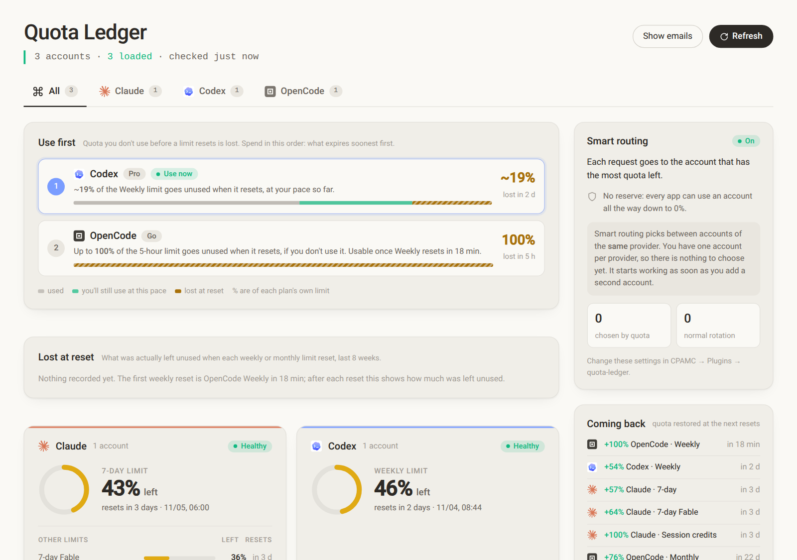
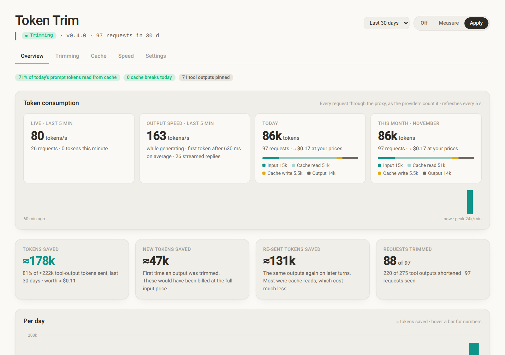
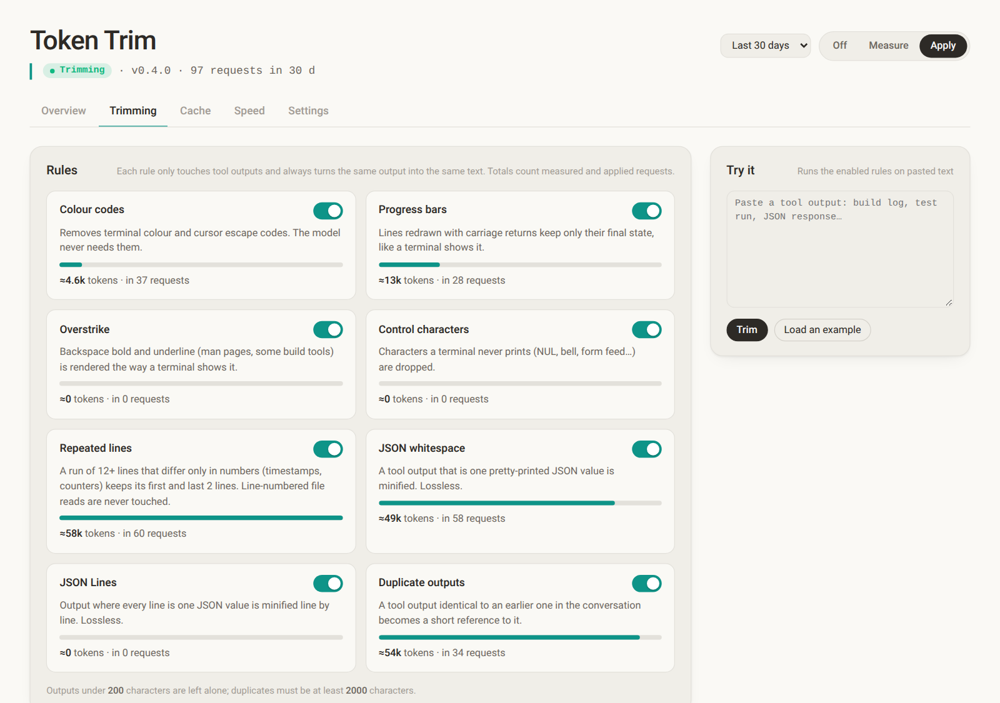
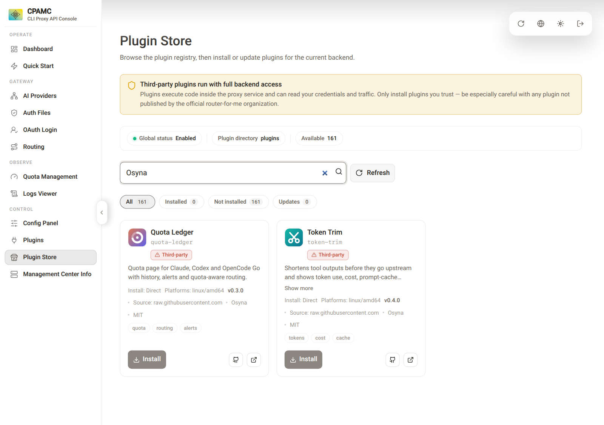

<a id="readme-top"></a>

<div align="center">

&nbsp;&nbsp;&nbsp;

# CPMAC Plugins

**Two plugins for [CLIProxyAPI](https://github.com/router-for-me/CLIProxyAPI).**<br/>
See how much of each Claude, Codex and OpenCode Go plan you have left, and cut the noise out of tool output before it costs you tokens.

[](https://github.com/Osyna/CPMAC-Plugins/actions)
[](LICENSE)
[](https://github.com/Osyna/CPMAC-Plugins/stargazers)

<br/>

<picture>
  <source media="(prefers-color-scheme: dark)" srcset="docs/images/quota-ledger-dark.png">
  
</picture>

</div>

<details>
<summary><kbd>Contents</kbd></summary>

- [What you get](#what-you-get)
- [Quota Ledger](#quota-ledger)
- [Token Trim](#token-trim)
- [Install](#install)
- [Settings you will actually change](#settings-you-will-actually-change)
- [Something is not working](#something-is-not-working)
- [Build from source](#build-from-source)

</details>

## What you get

| | Plugin | The problem it solves |
|---|---|---|
|  | **[Quota Ledger](quota-ledger/)** | Your plans reset on different days. Quota you do not use before a reset is gone, and you only notice when a limit hits 0%. |
|  | **[Token Trim](token-trim/)** | Coding agents send back every build log, colour code and progress bar on every turn. You pay for that text again and again. |

Both add a page to the management UI. They are independent: install one or both.

## Quota Ledger

Reads the quotas of your Claude, Codex and OpenCode Go accounts and tells you what to do with them.

- **Use first** ranks your accounts: spend the one whose limit resets soonest, and see how much each would lose at reset.
- **Lost at reset** records what was left unused each time a weekly or monthly limit reset.
- **Smart routing** (off until you turn it on, see [settings](#settings-you-will-actually-change)) sends each request to the account with the most quota left. When it cannot decide, CLIProxyAPI's own scheduler takes over, and it never rejects a request.
- **Alerts** for running low, running out before the reset, expired logins and failed checks. Optional webhook for Discord, Slack, ntfy or plain JSON.
- **Status bar and metrics**: a Waybar JSON route and a Prometheus route.

<details>
<summary>All the details are in the plugin README</summary>

[`quota-ledger/README.md`](quota-ledger/README.md) lists every route, every setting and the files it writes.

</details>

## Token Trim

Shortens **tool outputs** before they go upstream. Version 0.5 adds optional private archives, MCP retrieval and batched history archiving; these are off until configured. Ordinary trimming leaves prompts, system instructions, tool definitions, images and thinking blocks alone.

<div align="center">
<picture>
  <source media="(prefers-color-scheme: dark)" srcset="docs/images/token-trim-overview-dark.png">
  
</picture>
</div>

- **Thirteen rules:** terminal cleanup, JSON/JSON Lines minification, repeated and duplicate output reduction, recognised test/build/install folding, and lossless search/diagnostic grouping. Lossy folds mark what they omit; failures and protected source/patch output stay visible.
- **Stable cached views:** apply-mode outputs retain their first-sent form. Optional history cuts intentionally rebuild the prefix in growth batches rather than changing its boundary every turn.
- **Recoverable omissions:** an opt-in, caller/workspace-isolated archive stores originals before shortening. An authenticated MCP endpoint provides exact paginated reads and bounded keyword search; the Archive tab issues and revokes workspace tokens.
- **Starts in `measure` mode.** Ordinary rule savings are estimated without changing request bodies. Archive integration is disabled by default; see the plugin README before enabling raw-content storage.
- **Also shows** token use and cost at your own prices, cache hits and cache breaks, reply speed per model, and separate runtime archive byte counters.

<div align="center">
<picture>
  <source media="(prefers-color-scheme: dark)" srcset="docs/images/token-trim-rules-dark.png">
  
</picture>
</div>

<sub>Token Trim screenshots come from a demo instance fed with sample requests and a simulated upstream, not from live traffic. The Quota Ledger screenshot is a real instance with email addresses masked, which is the default.</sub>

<details>
<summary>All the details are in the plugin README</summary>

[`token-trim/README.md`](token-trim/README.md) explains each rule, the cache pinning and every setting.

Version 0.5 currently requires a source build. The store registry remains on the verified 0.4 artifact until the 0.5 release archive is published.

</details>

<div align="right">

[![][back-to-top]](#readme-top)

</div>

## Install

### Before you start

- CLIProxyAPI running in Docker with the management UI, from the stock [`docker-compose.yml`](https://github.com/router-for-me/CLIProxyAPI/blob/main/docker-compose.yml) (image `eceasy/cli-proxy-api`).
- A Linux amd64 machine. For anything else, [build from source](#build-from-source).
- A terminal in the folder that holds your `docker-compose.yml` and `config.yaml`.

> [!IMPORTANT]
> Plugins run inside the proxy and can read your credentials and traffic. That is how CLIProxyAPI plugins work, and the Plugin Store warns about it. The source is in this repo, and every download is checked against the SHA-256 pinned in [`registry.json`](registry.json).

### 1. Give the plugins a password and a place to save data

Quota Ledger reads your accounts through the management API, so it needs a key of its own. Create one and put it in a `.env` file next to `docker-compose.yml`:

```sh
echo "MANAGEMENT_PASSWORD=$(openssl rand -hex 24)" >> .env
mkdir -p data/quota-ledger data/token-trim
```

Open `docker-compose.yml` and add the three marked lines. The rest of your file stays as it is:

```yaml
services:
  cli-proxy-api:
    environment:
      DEPLOY: ${DEPLOY:-}
      MANAGEMENT_PASSWORD: ${MANAGEMENT_PASSWORD}           # add
    volumes:
      - ./plugins:/CLIProxyAPI/plugins                      # already there in the stock file
      - ./data/quota-ledger:/CLIProxyAPI/quota-ledger-data  # add
      - ./data/token-trim:/CLIProxyAPI/token-trim-data      # add
```

Without the two `data` lines the plugins still work, but they forget their history every time the container is recreated, for example when you pull a new image.

### 2. Turn plugins on and add this store

Add this to `config.yaml` (if you already have a `plugins:` section, add the missing lines to it):

```yaml
plugins:
  enabled: true
  store-sources:
    - "https://raw.githubusercontent.com/Osyna/CPMAC-Plugins/main/registry.json"
```

### 3. Restart

```sh
docker compose up -d
```

### 4. Install from the Plugin Store

Open the management UI, go to **Plugin Store**, search for `Osyna` and press **Install** on the plugins you want.

<div align="center">

</div>

The plugins are active right away and appear in the sidebar. If the store says a restart is needed, run `docker compose restart`.

### 5. Open them

- **Quota Ledger**: it needs your accounts to be logged in first (Auth Files or OAuth Login in the management UI).
- **Token Trim**: it counts traffic from the moment it is installed, so the page is empty until your tools have sent a few requests.

Both pages sign in with the key you used to log in to the management UI. Tick **Remember password** at login and they pick it up on their own. Otherwise they ask once per browser tab.

### Check it worked

```sh
docker logs cli-proxy-api 2>&1 | grep "plugin registered"
```

You should see one line per plugin, with its version.

### Update

When a new version is published, the Plugin Store shows an update on the plugin card. Your history and settings stay, because they live in `data/` and `config.yaml`, not in the container.

<div align="right">

[![][back-to-top]](#readme-top)

</div>

## Settings you will actually change

Everything is optional. Change these in `config.yaml` under `plugins.configs.<plugin>`, or on the **Plugins** page of the management UI. Changes apply without a restart.

| Plugin | Setting | Default | What it does |
|---|---|---|---|
| quota-ledger | `scheduler_mode` | `off` | Set to `most-remaining` to route each request to the account with the most quota left. Other modes: `soonest-reset`, `use-first`. `off` is a kill switch. |
| quota-ledger | `alert_below_percent` | `20` | Alert when a plan window drops under this. |
| quota-ledger | `webhook_url` | empty | Where alerts are sent: Discord, Slack, ntfy or JSON. |
| quota-ledger | `poll_interval_minutes` | `5` | How often quotas are checked. |
| token-trim | `mode` | `measure` | `off`, `measure` (record only) or `apply` (send trimmed outputs). |
| token-trim | `prices` | empty | Dollars per million tokens by model, so the page can show cost. |
| token-trim | `skip_tools` | empty | Tools whose output is never trimmed, for example `["Read"]`. |

The full lists are in the two plugin READMEs.

## Something is not working

| What you see | What to do |
|---|---|
| Quota Ledger says `MANAGEMENT_PASSWORD is not set` | Step 1 is missing. Add the variable to `docker-compose.yml`, then `docker compose up -d`. |
| A plugin page asks for the management key | Enter it once, or tick **Remember password** when you log in to the management UI. |
| There is no **Plugin Store** or **Plugins** entry, or the store says the backend does not support it | Your CLIProxyAPI is too old. Pull the latest image: `docker compose pull && docker compose up -d`. |
| The store does not list Quota Ledger or Token Trim | Check the `store-sources` line in `config.yaml`, then press **Refresh** in the store. |
| Plugins are installed but do not run | `plugins.enabled` must be `true` in `config.yaml`. |
| Quota Ledger cannot reach the management API | It looks at `http://127.0.0.1:8317` inside the container. If you changed the port, set `management_url` for the plugin. |
| After a CLIProxyAPI update a plugin fails to load | Plugins are built against a specific plugin interface. Check the store for a newer plugin version, or [build it from source](#build-from-source), then restart. |

## Build from source

Needs Docker. The plugins are built in Debian bookworm so their glibc matches the CLIProxyAPI image.

```sh
git clone https://github.com/Osyna/CPMAC-Plugins
cd CPMAC-Plugins
./quota-ledger/build.sh     # writes plugins/quota-ledger.so
./token-trim/build.sh       # writes plugins/token-trim.so
```

Copy the `.so` files into your CLIProxyAPI `plugins/` folder and restart the container. `.so` changes are not hot-reloaded.

Run the tests:

```sh
cd quota-ledger && go test ./...
cd ../token-trim && go test ./...
```

## License

[MIT](LICENSE)

[back-to-top]: https://img.shields.io/badge/-BACK_TO_TOP-151515?style=flat-square
